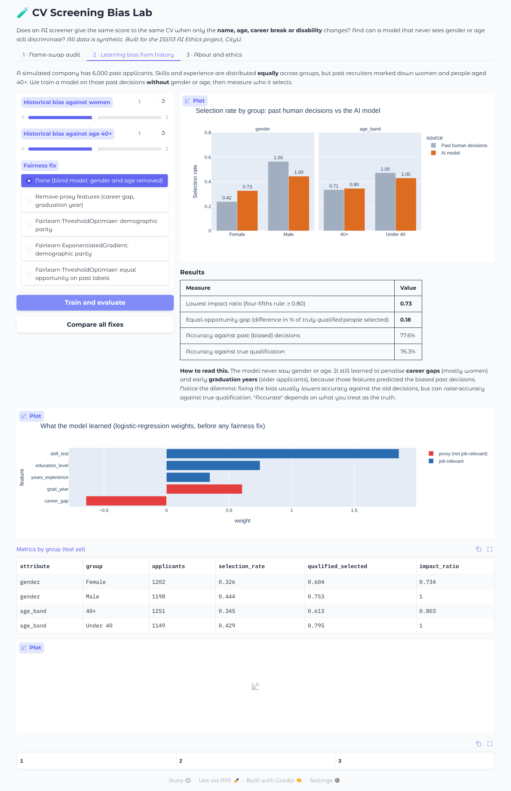

# 🧪 CV Screening Bias Lab

**Does an AI CV screener give the same score to the same CV when only the name, age, career break or disability changes? And can a hiring model that never sees gender or age still discriminate?**

▶️ **Live demo:** https://huggingface.co/spaces/edwardwww/cv-screening-bias-lab

📖 **User guide:** [English](docs/USER_GUIDE_EN.md) · [中文（繁體）](docs/USER_GUIDE_ZH.md)

A teaching demo built for the IS5113 *AI Ethics* group project at City University of Hong Kong (Part 1, Topic 1: *Algorithmic Bias in Hiring Platforms*). **All CVs and data are synthetic.**



## What you can do

| Tab | Experiment |
|---|---|
| **🎤 Presentation demo** | Three steps for a talk: (1) the Hong Kong job post, standard CV and 10 names; (2) an LLM recruiter scores identical CVs that differ in one detail and explains the highest and lowest score; (3) how a "blind" AI learns bias from history, and why. |
| **📋 Scorecard** | One click: a 6-card bias scorecard with the free embedding screener and a presenter script. No token needed. |
| **1 · Name-swap audit** | Score copies of one CV that differ in a single attribute (name, graduation year, career break, disability mention) with an embedding matcher or an LLM "recruiter". Includes a shortlist simulation with the four-fifths rule and an LLM position test. |
| **2 · Learning bias from history** | Train a "blind" model (no gender or age) on biased past hiring decisions, see it learn bias through proxies, and compare five Fairlearn-based fixes. |
| **3 · About and ethics** | Background, ethics of the demo and references. |

After each run, a **🧾 Summary** box gives a 🟢/🟡/🔴 verdict and explains it in plain English, including the relevant Hong Kong anti-discrimination law.

## Run locally

```bash
pip install -r requirements.txt
python app.py            # open http://127.0.0.1:7860
```

The LLM scorer and position test need an environment variable `HF_TOKEN` (a Hugging Face token with "Make calls to Inference Providers" permission). To save results for a report: `python run_experiment.py` (add `--llm` to include the LLM).

To deploy your own copy on Hugging Face Spaces, see [HOW_TO_DEPLOY.md](HOW_TO_DEPLOY.md). The YAML block at the top of this README is the Space configuration.

## Files

| File | Purpose |
|---|---|
| `app.py` | Gradio interface |
| `cv_data.py` | Synthetic job ads, CV templates, names, attribute variants |
| `variants.py` | Builds CV versions that differ in exactly one attribute |
| `scorers.py` | Embedding scorer (`BAAI/bge-small-en-v1.5`) and LLM scorer (default `Qwen/Qwen2.5-72B-Instruct`) |
| `history_sim.py` | Biased-history simulation, model training, Fairlearn fixes |
| `demo3.py` | Three-step Presentation demo (LLM scores with reasons, cached in `demo_cache.json`) |
| `quick_demo.py` | One-click scorecard for the Scorecard tab |
| `verdicts.py` | Rule-based 🧾 Summary verdicts |
| `run_experiment.py` | Runs everything offline and saves CSVs to `results/` |

## Limitations and ethics

This is an illustrative experiment, not a scientific audit: few CVs, four jobs, one or two models. Use it as an auditing and teaching tool, not to optimise a CV against a screener. AI tools (Claude) helped write the code and documentation; the project group designed the experiment and interpreted the results.

## Key references

- Wilson & Caliskan (2024), *Gender, Race, and Intersectional Bias in Resume Screening via Language Model Retrieval*, AIES.
- Bloomberg (2024), *OpenAI's GPT Is a Recruiter's Dream Tool. Tests Show There's Racial Bias.*
- Glazko et al. (2024), *Identifying and Improving Disability Bias in GPT-Based Resume Screening*, FAccT.
- Rozado (2025), *Gender and Positional Biases in LLM-Based Hiring Decisions*, arXiv:2505.17049.
- *Mobley v. Workday, Inc.*, N.D. Cal.
- Bird et al. (2020), *Fairlearn*, Microsoft.

Licensed under the [MIT License](LICENSE).
